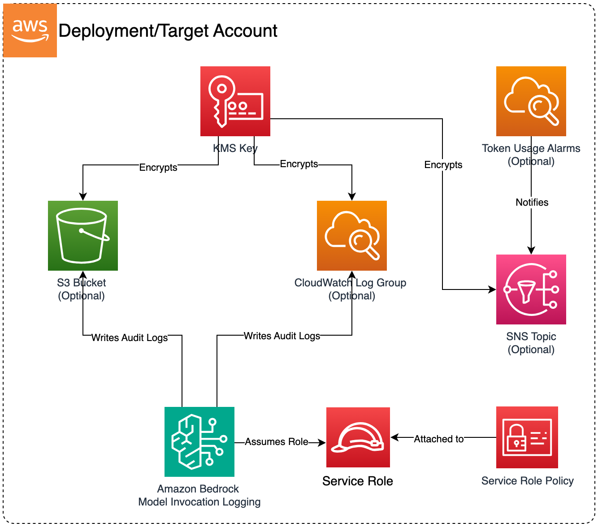

# Bedrock Settings

> **Note:** This documentation is also available in a rendered format [here](https://aws.github.io/modern-data-architecture-accelerator/packages/apps/ai/bedrock-settings-app/index.html).

Configures Amazon Bedrock model invocation audit logging to S3 and/or CloudWatch, providing monitoring and compliance capabilities for Bedrock model usage, and optional alarms on model token use. Use this module when you need to track and audit all Bedrock model invocations for compliance, cost monitoring, or operational visibility.

---

## Deployed Resources

This module deploys and integrates the following resources:

- **KMS Encryption Key**: Custom KMS key for encrypting Bedrock audit logs
- **S3 Bucket** (Optional): S3 bucket for storing Bedrock model invocation audit logs
- **CloudWatch Log Group** (Optional): CloudWatch Log Group for real-time monitoring of Bedrock model invocations with configurable retention policies
- **IAM Service Role**: Dedicated service role for Bedrock logging operations
- **IAM Managed Policy**: Custom policy granting permissions for Bedrock to write audit logs to the configured destinations
- **Custom Resource Lambda**: Lambda function that configures Bedrock's global model invocation logging settings through AWS APIs
- **Bucket Policy**: Resource-based policy allowing Bedrock service to write audit logs to the S3 bucket
- **KMS Key Policy**: Key policy allowing Bedrock, CloudWatch Logs, and S3 services to use the encryption key
- **Token Usage Alarms** (Optional): CloudWatch alarms on model input and output token counts, per model and/or account-wide, with SSM parameters for each alarm's name and ARN. See [Token usage alarms](#token-usage-alarms)
- **SNS Topic** (Optional): Topic the token usage alarms notify, when the module is asked to create one, with optional email subscriptions, its topic policy, and SSM parameters for its name and ARN



---

## Related Modules

- [Bedrock Builder](../bedrock-builder-app/README.md) — Deploy AgentCore Harnesses, Knowledge Bases, and Guardrails whose invocations will be captured by the audit logging configured here
- [Bedrock AgentCore Runtime](../bedrock-agentcore-runtime-app/README.md) — Deploy custom agent runtimes whose Bedrock model invocations will be captured by audit logging
- [GAIA v2](../gaia-v2-app/README.md) — Deploy a GenAI application backend whose Bedrock model invocations will be captured by audit logging

---

## Security/Compliance Details

This module is designed in alignment with MDAA security/compliance principles and CDK nag rulesets. Additional review is recommended prior to production deployment, ensuring organization-specific compliance requirements are met.

- **Encryption at Rest**:
  - All audit logs encrypted using a customer-managed KMS key
  - KMS key policy restricts access to the account root, Bedrock service, and logging services, plus, with a module-created alarm topic, the CloudWatch alarm service for this module's token alarms
- **Encryption in Transit**:
  - All log delivery uses TLS-encrypted connections
- **Least Privilege**:
  - Dedicated IAM service role scoped to logging destinations only
  - S3 bucket policy uses condition-based access controls with source account and ARN restrictions
  - Cross-service access uses proper service principals and condition keys
- **Logging & Audit**:
  - Supports real-time monitoring via CloudWatch for Bedrock model invocation audit logs
  - Supports long-term storage via S3 for Bedrock model invocation audit logs
  - Configurable log retention policies for compliance requirements
- **Monitoring**:
  - Optional token usage alarms notify an existing SNS topic, or a module-created topic encrypted with the module KMS key
  - CloudWatch's publish grant on a module-created topic, and its use of the KMS key, are limited to this module's token alarms

---

## Token usage alarms

`tokenUsageAlarms` alarms when Bedrock model token use in a period exceeds a threshold:

```yaml
tokenUsageAlarms:
  notificationTopicArn: 'arn:{{partition}}:sns:{{region}}:{{account}}:ai-platform-alerts'
  models:
    nova-micro:
      modelIds: ['amazon.nova-micro-v1:0', 'us.amazon.nova-micro-v1:0']
      inputTokenThreshold: 5000000
      outputTokenThreshold: 1000000
  accountTotal:
    inputTokenThreshold: 50000000
  periodSeconds: 3600 # optional
```

- **Account-wide** - Bedrock publishes `InputTokenCount` and `OutputTokenCount` in the `AWS/Bedrock` namespace for the whole account, not per agent or application. Every alarm counts every caller of the model IDs it covers in this account and Region, whether or not MDAA deployed them.
- **Model IDs are matched exactly** - the `ModelId` dimension is the model or inference-profile ID exactly as the caller passed it, so `amazon.nova-micro-v1:0`, `us.amazon.nova-micro-v1:0`, and a `global.` profile for the same model are separate series. A `models` entry sums the IDs it lists, up to 10. Calls made through an ID it doesn't list, such as another inference profile for the same model, are not counted.
- **Account total** - `accountTotal` alarms on the series Bedrock publishes without a dimension, the total across all model IDs.
- **Not counted** - inference through the OpenAI-compatible `bedrock-mantle` endpoint publishes to a separate `AWS/BedrockMantle` namespace, so these alarms don't count it. Prompt-cache reads and writes are published as separate metrics, `CacheReadInputTokenCount` and `CacheWriteInputTokenCount`, which these alarms don't watch.
- **Timing** - `periodSeconds` is a whole number of minutes, because Bedrock publishes token metrics at one-minute resolution. `periodSeconds` x `evaluationPeriods` can be at most 1 day for a period under an hour, and at most 7 days otherwise.
- **Notification** - an existing topic (`notificationTopicArn`), or a topic the module creates, encrypted with the module KMS key (`createNotificationTopic`, with `notificationEmails` to subscribe addresses).

See the [AWS runtime metrics documentation](https://docs.aws.amazon.com/bedrock/latest/userguide/monitoring-runtime-metrics.html) for the metrics and their dimensions.

---

## Configuration

### MDAA Config

Add the following snippet to your mdaa.yaml under the `modules:` section of a domain/env in order to use this module:

```yaml
bedrock-settings: # Module Name can be customized
  module_path: '@aws-mdaa/bedrock-settings' # Must match module NPM package name
  module_configs:
    - ./bedrock-settings.yaml # Filename/path can be customized
```

### Module Config Samples and Variants

Copy the contents of the relevant sample config below into the `./bedrock-settings.yaml` file referenced in the MDAA config snippet above.

#### Minimal Configuration

Enables audit logging to both CloudWatch and S3 with default settings. Start here when you need basic Bedrock invocation auditing with sensible defaults and plan to tune retention or destinations later.

[sample-config-minimal.yaml](sample_configs/sample-config-minimal.yaml)

```yaml
# Contents available via above link
--8<-- "target/docs/packages/apps/ai/bedrock-settings-app/sample_configs/sample-config-minimal.yaml"
```

#### Comprehensive Configuration

Configures audit logging for Bedrock model invocations to both S3 (long-term retention) and CloudWatch (real-time monitoring), and alarms on token use per model and account-wide. Use this as a reference when you need full control over log retention, encryption, dual-destination audit configuration, and token usage alerting.

[sample-config-comprehensive.yaml](sample_configs/sample-config-comprehensive.yaml)

```yaml
# Contents available via above link
--8<-- "target/docs/packages/apps/ai/bedrock-settings-app/sample_configs/sample-config-comprehensive.yaml"
```

#### Token Usage Alarms with an Existing Notification Topic

Configures CloudWatch audit logging and an account-wide token usage alarm that notifies an existing SNS topic through `tokenUsageAlarms.notificationTopicArn`, instead of a topic the module creates. Use this when you already manage a central operations or cost topic. It has its own sample because `notificationTopicArn` and `createNotificationTopic` (used in the comprehensive configuration) are mutually exclusive. See [Token usage alarms](#token-usage-alarms).

[sample-config-token-alarms-existing-topic.yaml](sample_configs/sample-config-token-alarms-existing-topic.yaml)

```yaml
# Contents available via above link
--8<-- "target/docs/packages/apps/ai/bedrock-settings-app/sample_configs/sample-config-token-alarms-existing-topic.yaml"
```

---

[Config Schema Docs](SCHEMA.md)
