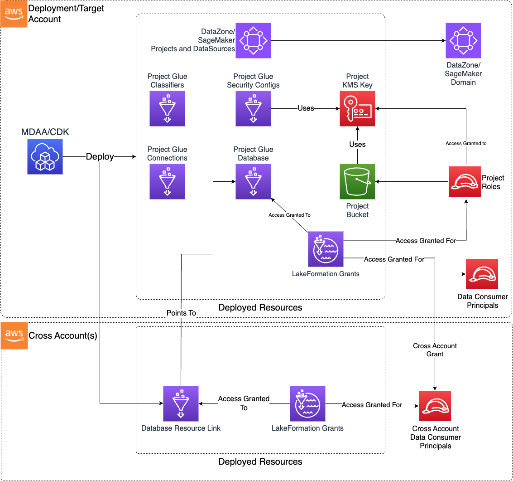

# DataOps Project

> **Note:** This documentation is also available in a rendered format [here](https://aws.github.io/modern-data-architecture-accelerator/packages/apps/dataops/dataops-project-app/index.html).

Deploys shared DataOps project infrastructure including KMS keys, S3 project buckets, Glue databases, Lake Formation grants, security configurations, security groups, Glue connections/classifiers, and optional DataZone/SageMaker project integration. Use this module as the foundation for any data operations project, providing the shared encryption, storage, networking, and catalog resources that other DataOps modules depend on.

---

## Deployed Resources

This module deploys and integrates the following resources:

**Project KMS Key** - Customer-managed KMS key used to encrypt all project resources at rest.

**Project S3 Bucket** - Storage for project activities (scratch, temporary, scripts, artifacts). Used as temp location for all project Glue jobs and to deploy/stage Glue job code.

**Glue Databases** - Catalog databases for crawled/generated tables.

**LakeFormation Grants** - Data lake location and read/write permission grants for project roles, with optional cross-account resource links and tag-based access control. The `createReadWriteGrantsForProjectExecutionRoles` flag accepts the case-sensitive permission levels `read`, `write`, and `super` in addition to boolean values, where `true` is equivalent to `write` and `super` additionally grants table `ALTER`/`DROP` and database `DROP`. Select `super` only for execution roles whose ETL jobs must replace or recreate catalog objects; because `ALTER`/`DROP` are destructive privileges that expand the role's blast radius, prefer `read` or `write` (the least-privilege levels) by default and reserve `super` for roles that genuinely require it.

**Project Glue Security Config** - Encrypts all job output, logging, and bookmark data with the project KMS key.

**Project Security Groups** - Configurable security groups for Glue connections and other project resources.

**Glue Connections** - Network and JDBC connections for reuse across project jobs and crawlers.

**Glue Custom Classifiers** - Classifiers (CSV, Grok, JSON, XML) for reuse across project crawlers.

**DataZone/SageMaker Project** (Optional) - Registers DataOps project resources as DataZone/SageMaker project, data sources, and assets. On the SageMaker path, raw S3 locations (outside the Glue catalog) can also be registered as data sources via `sagemaker.project.dataSources.<name>.s3`. `sagemaker.project.glossaries` and `metadataForms` take the same fields as the SageMaker Project module (this module builds `SagemakerProjectL3Construct` under the hood) - see that module's [Glossaries](../../governance/sagemaker-project-app/README.md#glossaries) section for the config surface, including `description`/`readme`/`relatesTo`.

**Subscription Role Authorization** (Optional) - Created when `subscriptionAuthorizedRoleGroups` is set: a Lambda-backed custom resource (`Custom::DataZoneProjectRoleTagger`, SageMaker path) that tags the listed roles with the project ID, and a managed policy (`subscription-catalog-key-access`) granting the listed roles decrypt on the domain's Glue catalog keys. On the DataZone path the roles are added to the project's subscription target instead of being tagged. See [Subscribed Asset Access for Project Roles](#subscribed-asset-access-for-project-roles).

**Environment ID Resolution** - For each `sagemaker.project.environmentConfigs` entry (SageMaker path), a Lambda-backed custom resource (`Custom::EnvironmentIdResolver`) resolves the environment's live ID and publishes it to an SSM parameter at `<ssmPath>/project/dataops-env-<configKey>/environment-id` on every deploy, for use with the optional `environmentId` property. Setting `environmentId` is required to rename a project (or make any other change) once its environments are already `ACTIVE` - DataZone rejects such updates addressed by configuration name. See [RENAMING_PROJECTS.md](../../../constructs/L2/datazone-constructs/RENAMING_PROJECTS.md) for details.

**SNS Failure Notification Topic** - SNS topic for publishing DataOps pipeline failure events, with optional email subscriptions.



---

## Related Modules

- [ETL Jobs](../dataops-job-app/README.md) — Deploy Glue ETL jobs that use project KMS keys, security configs, and connections
- [Crawlers](../dataops-crawler-app/README.md) — Deploy Glue Crawlers that use project security configuration and connections
- [Lambda Functions](../dataops-lambda-app/README.md) — Deploy Lambda functions for data operations using project KMS keys and security groups
- [Workflows](../dataops-workflow-app/README.md) — Orchestrate project crawlers and jobs with Glue Workflows
- [Step Functions](../dataops-stepfunction-app/README.md) — Orchestrate project resources with Step Functions state machines
- [DataBrew](../dataops-databrew-app/README.md) — Deploy DataBrew jobs using project KMS keys for data profiling and transformation
- [DynamoDB](../dataops-dynamodb-app/README.md) — Deploy DynamoDB tables encrypted with the project KMS key
- [DMS](../dataops-dms-app/README.md) — Deploy DMS replication tasks using project KMS keys for data migration
- [Data Quality](../dataops-data-quality-app/README.md) — Deploy Glue Data Quality rulesets for project databases and tables
- [Dashboard](../dataops-dashboard-app/README.md) — Create CloudWatch dashboards aggregating metrics from project Lambda functions and resources
- [NiFi](../dataops-nifi-app/README.md) — Deploy Apache NiFi clusters using project KMS keys for data flow management
- [Data Lake](../../datalake/datalake-app/README.md) — Deploy data lake buckets that project jobs can read from and write to
- [Lake Formation Access Control](../../governance/lakeformation-access-control-app/README.md) — Manage Lake Formation grants for Glue resources created outside of the project
- [Glue Catalog](../../governance/glue-catalog-app/README.md) - Share a producer account's Glue Catalog and catalog key with consumer accounts, which subscriptions to tables in other accounts require
- [SageMaker (Domain)](../../governance/sagemaker-app/README.md) — Integrate project resources as SageMaker project data sources
- [Roles](../../governance/roles-app/README.md) — Create IAM roles for data engineer, execution, and data admin access

---

## Security/Compliance Details

This module is designed in alignment with MDAA security/compliance principles and CDK nag rulesets. Additional review is recommended prior to production deployment, ensuring organization-specific compliance requirements are met.

- **Encryption at Rest**:
  - Project KMS key encrypts all project resources (S3 bucket, Glue security config, job outputs, logs, bookmarks)
  - Optional separate S3 output KMS key for data lake integration
- **Least Privilege**:
  - KMS key usage access granted to project data engineer and execution roles via key policy
  - KMS key usage/admin access granted to data admin role via key policy
  - Project bucket read/write access granted by prefix to data engineer, execution, and data admin roles
  - JDBC connection credentials managed via Secrets Manager dynamic references
  - Lake Formation grants with tag-based access control and per-database/table permissions
  - Subscription role tagging (SageMaker path) can set the `AmazonDataZoneProject` tag only on the listed roles and only to this project's ID, and can remove it only from roles that hold this project's ID
  - Roles in the groups listed in `subscriptionAuthorizedRoleGroups` (opt-in) receive the project's subscribed tables: through the `AmazonDataZoneProject` tag on the SageMaker path, which also makes them Lake Formation members of the project, or as authorized principals of the subscription target on the DataZone path. They also get `kms:DescribeKey` on the domain's Glue catalog keys, and `kms:Decrypt` on them only through Glue (`kms:ViaService`), so they cannot decrypt Glue connection passwords directly. Roles referenced by a literal ARN in another account are left out. Roles marked `sso` or `immutable`, or referenced by an IAM Identity Center ARN or role name, are never tagged and never get the catalog key policy, so they receive subscribed tables only on the DataZone path
- **Separation of Duties**:
  - Role-based access at data engineer, execution, and data admin levels
  - Cross-account resource links for multi-account data governance
- **Network Isolation**:
  - Configurable security groups with self-referencing ingress (required by Glue)
  - All egress permitted by default, all other ingress denied
  - VPC and JDBC connections for private network access

---

## Subscribed Asset Access for Project Roles

When a DataZone or SageMaker Unified Studio (SMUS) project subscribes to a Glue table, the table is granted to the project's own role only. Glue jobs and crawlers from other DataOps modules run under `projectExecutionRoles`, and engineers and admins query from Athena under their own roles, so none of them can read subscribed tables by default.

Set `subscriptionAuthorizedRoleGroups` under `sagemaker` or `datazone` to list the role groups that should receive the project's subscriptions: `projectExecutionRoles`, `dataEngineerRoles`, and `dataAdminRoles`. A role in more than one listed group is authorized once if every group references it the same way, or one group by name and another by literal ARN, so reference each role the same way in every group. Access follows the subscription workflow: a listed role is granted a table when a subscription is approved and loses it when the subscription is revoked, without a redeploy.

```yaml
sagemaker:
  domainConfigSSMParam: /sample-org/shared/sagemaker/domain/test-domain/config
  subscriptionAuthorizedRoleGroups:
    - projectExecutionRoles
    - dataEngineerRoles
  project:
    profileName: test-profile
```

### What a listed role receives

The tables the project subscribes to, plus decrypt access through Glue to the domain's Glue catalog keys, which reading a table from another account's catalog requires. Everyone who can assume a listed role gets this access, so list engineer and admin groups only when all of their users should read every subscribed table. For a role whose trust policy trusts the account root, that includes every SMUS project user role in the account, which `SageMakerStudioProjectUserRolePolicy` allows to assume any role, and on the SageMaker path this project's EMR instance role, which `SageMakerStudioEMRInstanceRolePolicy` allows to assume roles tagged for its project. Give listed roles trust policies that name specific principals.

- **SageMaker path**: each role is tagged `AmazonDataZoneProject=<projectId>`. SMUS fulfills subscriptions with Lake Formation grants to the principals carrying the consumer project's ID in that tag, which includes subscriptions approved before the role was listed. The tag also makes the role a Lake Formation member of the project, with create, drop, and write on the project database. AWS documents that Lake Formation treats this tag key specially ([ABAC considerations](https://docs.aws.amazon.com/lake-formation/latest/dg/abac-considerations.html)) but not that SMUS grants subscriptions by it, so treat the subscription grants as observed behavior.
- **Lake Formation enforcement (SageMaker path)**: Lake Formation treats every principal carrying the `AmazonDataZoneProject` tag as opted in to Lake Formation permissions for all Data Catalog resources ([ABAC considerations](https://docs.aws.amazon.com/lake-formation/latest/dg/abac-considerations.html)). A listed role therefore stops receiving access through `IAMAllowedPrincipals` or hybrid access mode on every Data Catalog table, not only the project's, and needs Lake Formation permissions on each database and table it uses. Grant those before listing a role whose jobs, crawlers, or queries rely on IAM-only access.
- **DataZone path**: each role is added to the authorized principals of the subscription target MDAA creates for the project. DataZone grants a subscribed table to the target's principals when it fulfills the subscription, so the role receives the subscriptions fulfilled after it is listed; AWS does not document that subscriptions fulfilled earlier are granted to it. Nor does AWS document whether removing a role from the target revokes the grants already made to it, so after unlisting a role, check its Lake Formation permissions and revoke any that remain.

### Limits

- **Roles in the project's account only.** Grants reach only roles in the consumer project's own account; the subscribed tables can come from a producer in any account (see [Related settings](#related-settings)). A role referenced by a literal ARN in another account is left out with a warning; a role resolved at deploy time (for example `ssm-org:`) cannot be checked at synth and must be in the project's account.
- **One project per role (SageMaker path).** A role tag holds one value. Deployment fails, naming the role and the other project, if a listed role is already tagged for another project.
- **IAM Identity Center roles (SageMaker path).** IAM rejects changes to `AWSReservedSSO_*` roles that do not come from IAM Identity Center, so they cannot be tagged. MDAA leaves out roles marked `sso: true` or `immutable: true`, and roles referenced by an Identity Center ARN or an `AWSReservedSSO_*` name, with a warning. Mark Identity Center roles `sso: true`; one referenced by a value resolved at deploy time fails the deployment when it is tagged.
- **Nine roles (DataZone path).** A subscription target allows 10 authorized principals, one of which is the environment user role, so synth fails if the listed groups contain more than nine distinct role references. A role referenced in different ways (for example by `id:` in one group and by name in another) counts, and is authorized, once per way. Roles marked `sso: true` or `immutable: true`, and roles referenced by an Identity Center ARN or an `AWSReservedSSO_*` name, are authorized but get no catalog key policy, because MDAA does not attach policies to them.
- **Adding roles to an existing target (DataZone path).** The DataZone `UpdateSubscriptionTarget` API reference says authorized principal updates are supported in batches of 5, so adding more than five roles to an existing project's target in one deployment may fail. If it does, add them over several deployments.
- **Removal (SageMaker path).** Unlisting a role or destroying the module removes the tag, but only while it still holds this project's ID; MDAA can only remove the current project's tag. A role keeps another project's ID in two cases: a deployment replaces the SMUS project (so its ID changes) and unlists the role, which keeps the old project's ID; or a deployment replaces the project and lists the role, then rolls back, and the role keeps the ID of the project the rollback removes. The tagging handler logs a warning naming the role. Remove the tag manually before authorizing the role into another project.
- **Recreated roles (SageMaker path).** MDAA tags roles only when the listed roles or the project change, so a listed role that is deleted and recreated under the same name stays untagged until such a deployment.

### Related settings

- **Guard the tag (SageMaker path).** Lake Formation matches the `AmazonDataZoneProject` tag on IAM roles and users and on session tags ([attribute-based access control](https://docs.aws.amazon.com/lake-formation/latest/dg/attribute-based-access-control.html)), and a session tag overrides a role tag with the same key. So anyone who can set the tag can authorize a principal into a project: with `iam:TagRole` or `iam:TagUser`, by creating a role or user with the tag, or by passing it as a session tag when assuming a role whose trust policy allows `sts:TagSession`, including through SAML or OIDC federation and IAM Identity Center attributes for access control. Restrict the key, for example with an SCP that denies `iam:TagRole`, `iam:UntagRole`, `iam:TagUser`, `iam:UntagUser`, `iam:CreateRole`, `iam:CreateUser`, and `sts:TagSession` when `ForAnyValue:StringEquals` on `aws:TagKeys` includes `AmazonDataZoneProject`. Exempt the MDAA deployment role, this module's tagging handler role, the roles SMUS uses to provision projects, and the SMUS project user roles (`datazone_usr_role_*`), which pass their own project ID as a session tag when they assume roles. An SCP does not cover federation, so also keep identity provider and Identity Center attribute mappings from passing the tag.
- **Glue 5.0 Spark SQL.** Glue 5.0 jobs that read subscribed tables with native Spark SQL also need the Lake Formation application integration setting **Allow external engines to access data in Amazon S3 locations with full table access**.
- **Producers in other accounts.** SMUS can fulfill a subscription to a table in another account only if that account's [Glue Catalog](../../governance/glue-catalog-app/README.md) module lists the consumer account in `consumerAccounts` or `kmsKeyConsumerAccounts`.

---

## Configuration

### MDAA Config

Add the following snippet to your mdaa.yaml under the `modules:` section of a domain/env in order to use this module:

```yaml
dataops-project: # Module Name can be customized
  module_path: '@aws-mdaa/dataops-project' # Must match module NPM package name
  module_configs:
    - ./dataops-project.yaml # Filename/path can be customized
```

### Module Config Samples and Variants

Copy the contents of the relevant sample config below into the `./dataops-project.yaml` file referenced in the MDAA config snippet above.

#### Minimal Configuration

Contains only the required property (dataAdminRoles) plus one database to demonstrate the core use case. Start here for a basic DataOps project with a single Glue database and admin role.

[sample-config-minimal.yaml](sample_configs/sample-config-minimal.yaml)

```yaml
# Contents available via above link
--8<-- "target/docs/packages/apps/dataops/dataops-project-app/sample_configs/sample-config-minimal.yaml"
```

#### Comprehensive Configuration

Covers all available configuration options using the SageMaker integration path. Start here when evaluating all available options for databases, connections, classifiers, Lake Formation grants, SageMaker integration, and S3 lifecycle rules for the project bucket (expiring transient temp/query data and aging cold data to cheaper storage classes).

[sample-config-comprehensive.yaml](sample_configs/sample-config-comprehensive.yaml)

```yaml
# Contents available via above link
--8<-- "target/docs/packages/apps/dataops/dataops-project-app/sample_configs/sample-config-comprehensive.yaml"
```

#### SageMaker Integration Configuration

Extends the primary configuration with SageMaker domain integration, project profiles, and data sources for SageMaker-governed data access. Choose this variant when your organization uses SageMaker Unified Studio for data governance and you want project resources automatically registered as SageMaker data sources.

[sample-config-sagemaker.yaml](sample_configs/sample-config-sagemaker.yaml)

```yaml
# Contents available via above link
--8<-- "target/docs/packages/apps/dataops/dataops-project-app/sample_configs/sample-config-sagemaker.yaml"
```

#### DataZone Integration Configuration

Uses Amazon DataZone for data governance and catalog management instead of SageMaker Unified Studio. Choose this variant when your organization uses DataZone for data discovery and access management.

[sample-config-datazone.yaml](sample_configs/sample-config-datazone.yaml)

```yaml
# Contents available via above link
--8<-- "target/docs/packages/apps/dataops/dataops-project-app/sample_configs/sample-config-datazone.yaml"
```

---

[Config Schema Docs](SCHEMA.md)
