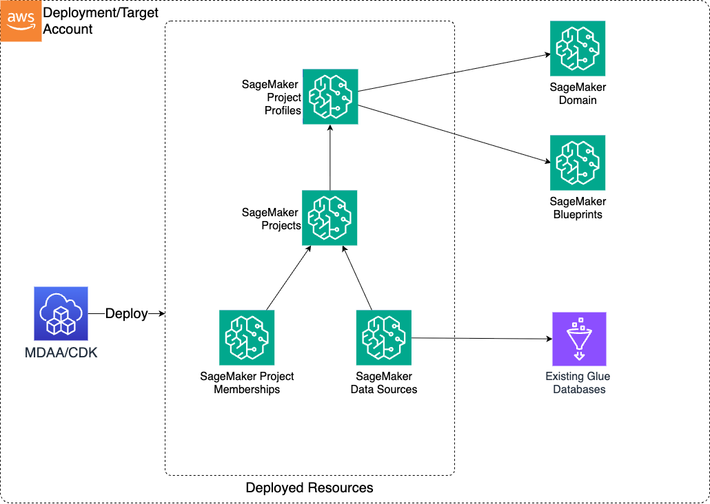

# SageMaker Project

> **Note:** This documentation is also available in a rendered format [here](https://aws.github.io/modern-data-architecture-accelerator/packages/apps/governance/sagemaker-project-app/index.html).

Deploys SageMaker Unified Studio projects, project profiles, and associated data sources for organizing and managing analytics workloads within a SageMaker domain. Use this module when you need to create governed analytics projects within SageMaker Unified Studio, with data sources imported from your Glue Catalog for team-based data exploration and publishing.

Note: SageMaker Projects can also be deployed via the [DataOps Project module](../../dataops/dataops-project-app/README.md), allowing for automatic registration of Glue-based data sources and discovery of data assets. This module can be used when all data assets will be created and consumed entirely within SageMaker.

---

## Deployed Resources

This module deploys and integrates the following resources:

**Project Profiles** - Enables blueprints for use in projects, with configurable environment templates.

**Projects** - SageMaker Unified Studio (DataZone V2) projects created within a domain.

**Data Sources** - Allows importing of existing Glue databases, or raw S3 locations, as data sources into SageMaker projects for publishing.

**Metadata Form Types** - Project-owned DataZone metadata form types, defined declaratively by their fields. MDAA assembles the Smithy model, so config authors do not write Smithy. See [Metadata Form Types](#metadata-form-types) below for naming rules and the domain-redeploy prerequisite.

**Glossaries** - Project-owned DataZone business glossaries and terms, defined declaratively. A metadata form field's `glossaryId` can reference a declared glossary or term, resolved to the glossary's deploy-time ID. See [Glossaries](#glossaries) below for the config surface and the domain-redeploy prerequisite.

**Environment ID Resolution** - For each `environmentConfigs` entry, a Lambda-backed custom resource (`Custom::EnvironmentIdResolver`) resolves the environment's live ID and publishes it to an SSM parameter at `<ssmPath>/project/<key>-env-<configKey>/environment-id` on every deploy, for use with the optional `environmentId` property. Setting `environmentId` is required to rename a project (or make any other change) once its environments are already `ACTIVE` - DataZone rejects such updates addressed by configuration name. See [RENAMING_PROJECTS.md](../../../constructs/L2/datazone-constructs/RENAMING_PROJECTS.md) for details.



---

## Related Modules

- [SageMaker (Domain)](../sagemaker-app/README.md) — Deploy the SageMaker domain that hosts projects created by this module
- [DataOps Project](../../dataops/dataops-project-app/README.md) — Alternative way to deploy SageMaker projects with automatic Glue data source registration
- [Glue Catalog Settings](../glue-catalog-app/README.md) — Configure cross-account Glue Catalog access for data sources imported into SageMaker projects
- [Lake Formation Access Control](../lakeformation-access-control-app/README.md) — Manage fine-grained Lake Formation grants for data sources used by SageMaker projects

---

## Security/Compliance Details

This module is designed in alignment with MDAA security/compliance principles and CDK nag rulesets. Additional review is recommended prior to production deployment, ensuring organization-specific compliance requirements are met.

- **Encryption at Rest**:
  - Projects inherit the domain-level customer-managed KMS encryption configuration
- **Least Privilege**:
  - Projects are scoped to specific domain units and project profiles
  - Glue-based data sources use Lake Formation access control grants for fine-grained permissions on imported Glue databases
  - S3-based data sources grant the project's environment user role IAM read (list and get) on the registered bucket and prefix; the bucket policy and KMS key must also allow that role
  - Registering an S3 Access Grants location (`registerS3AccessGrantLocation`) is optional and additive

---

## AWS Service Endpoints

When DataZone blueprints provision VPC-bound environments (e.g., SageMaker Studio, Athena, Glue), the following VPC endpoints may be required if public AWS service endpoint connectivity is unavailable (e.g., private subnets without NAT gateway, firewalled environments, or PrivateLink-only architectures). Specific endpoints depend on which blueprints are enabled:

| AWS Service       | Endpoint Service Name                      | Type      |
| ----------------- | ------------------------------------------ | --------- |
| DataZone          | `com.amazonaws.{region}.datazone`          | Interface |
| SageMaker API     | `com.amazonaws.{region}.sagemaker.api`     | Interface |
| SageMaker Runtime | `com.amazonaws.{region}.sagemaker.runtime` | Interface |
| SageMaker Studio  | `com.amazonaws.{region}.studio`            | Interface |
| Athena            | `com.amazonaws.{region}.athena`            | Interface |
| Glue              | `com.amazonaws.{region}.glue`              | Interface |
| Lake Formation    | `com.amazonaws.{region}.lakeformation`     | Interface |
| KMS               | `com.amazonaws.{region}.kms`               | Interface |
| S3                | `com.amazonaws.{region}.s3`                | Gateway   |
| CloudWatch Logs   | `com.amazonaws.{region}.logs`              | Interface |
| STS               | `com.amazonaws.{region}.sts`               | Interface |
| EFS               | `com.amazonaws.{region}.elasticfilesystem` | Interface |

---

## Configuration

### MDAA Config

Add the following snippet to your mdaa.yaml under the `modules:` section of a domain/env in order to use this module:

```yaml
sagemaker-project: # Module Name can be customized
  module_path: '@aws-mdaa/sagemaker-project' # Must match module NPM package name
  module_configs:
    - ./sagemaker-project.yaml # Filename/path can be customized
```

### Data Sources

A project's `dataSourceDefaults` supplies `publishOnImport`, `enableSetting`, `schedule`, `recommendation`, `autoImportDataQualityResult`, and `filterExpressions` values inherited by every Glue database (`databaseName`) entry in `dataSources`; an `s3` entry has no equivalent `AWS::DataZone::Connection` properties, so these defaults are silently not applied to it, and setting one of these fields directly on an `s3` entry itself (rather than inheriting it) fails synth with a clear error. A Glue database data source that sets one of these fields itself replaces the corresponding default entirely for that field — fields are not deep-merged, so a data source overriding `schedule` must supply the whole `schedule` object, not just the part that differs. There is no way for a data source to opt out of an inherited `schedule` other than setting its own `enableSetting` to `DISABLED`, which disables the whole data source.

In the DataOps Project module's SMUS (`sagemaker`) mode, `sagemaker.project.dataSourceDefaults` also applies to the project's own database-backed data sources (`databases.<db>.createSagemakerDatasource`/`createDatazoneDatasource`), since those share this module's `SageMakerProjectProps` type; see that module's README.

A Glue database data source's `metadataForms` attaches the project's own `metadataForms` (declared under the same project, in any order relative to `dataSources`) to every asset the data source imports, pre-populating form field values via `content`. The map key must match a key declared under the project's `metadataForms` and reference an `ENABLED` form; `content`, if set, must be valid JSON naming only fields the form declares, and every field the form declares `required: true` must be present (via `content` or otherwise). Any violation fails synth with a clear error. `metadataForms` only applies to Glue database data sources (`databaseName`) — setting it on an `s3` data source fails synth, since an `AWS::DataZone::Connection` has no equivalent property.

### Metadata Form Types

Form and field names must be valid Smithy identifiers (letter or underscore first, then letters, digits, or underscores), and form names must be unique across the domain. Deleting a form type on stack teardown is best-effort: if DataZone rejects the delete (for example, because the form is still attached to assets), the form type is left in place. Existing deployments must redeploy the DataZone/SageMaker domain module before deploying a project with `metadataForms`, so that the domain grants form-type creation to the custom-resource role.

### Glossaries

The glossary key is used verbatim as the DataZone glossary name, which must be unique across the domain, not just the project. A field's `glossaryId` may reference a declared glossary under the project's `glossaries` as `"<glossaryName>"`, or a declared term as `"<glossaryName>.<termName>"`, resolved to that glossary's deploy-time ID; or a literal, pre-existing glossary ID string, unchanged. On teardown, MDAA deletes the declared terms, then disables and deletes the glossary. Both deletes are best-effort: if DataZone rejects one, the resource is left in place and the stack update still succeeds. If a leftover glossary later blocks recreating one with the same name, delete the existing glossary directly in DataZone, or, if you are moving a glossary between projects, remove it from `glossaries` and deploy, then add it back. A glossary or term can't move between projects or domains: Update detects this and fails clearly rather than attempting an unsupported move. Existing deployments must redeploy the DataZone/SageMaker domain module before deploying a project with `glossaries`, so that the domain grants glossary creation to project owners.

### Module Config Samples and Variants

Copy the contents of the relevant sample config below into the `./sagemaker-project.yaml` file referenced in the MDAA config snippet above.

#### Minimal Configuration

Deploys a single SageMaker project with a project profile. Start here for a basic SageMaker project within an existing domain.

[sample-config-minimal.yaml](sample_configs/sample-config-minimal.yaml)

```yaml
# Contents available via above link
--8<-- "target/docs/packages/apps/governance/sagemaker-project-app/sample_configs/sample-config-minimal.yaml"
```

#### Comprehensive Configuration

Covers both ON_CREATE and ON_DEMAND deployment modes, environment templates, project profiles with all options, and projects with full membership. Use this as a reference when you need full control over deployment modes, environment templates, data sources, and project membership.

[sample-config-comprehensive.yaml](sample_configs/sample-config-comprehensive.yaml)

```yaml
# Contents available via above link
--8<-- "target/docs/packages/apps/governance/sagemaker-project-app/sample_configs/sample-config-comprehensive.yaml"
```

The comprehensive sample's `SimpleForm` metadata form is factored out into its own file and pulled in via `!includeYaml`. This file must sit next to the module config (i.e. in the same directory as `sagemaker-project.yaml`) for the reference to resolve.

[simple-metadata-form.yaml](sample_configs/simple-metadata-form.yaml)

```yaml
# Contents available via above link
--8<-- "target/docs/packages/apps/governance/sagemaker-project-app/sample_configs/simple-metadata-form.yaml"
```

---

[Config Schema Docs](SCHEMA.md)
