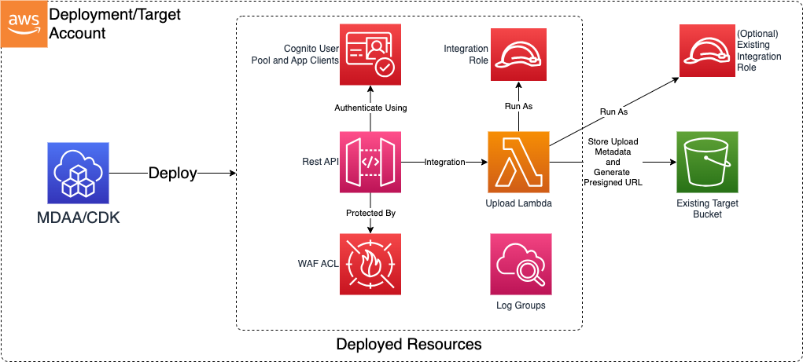

# Machine to Machine API

> **Note:** This documentation is also available in a rendered format [here](https://aws.github.io/modern-data-architecture-accelerator/packages/apps/utility/m2m-api-app/index.html).

Deploys a secure REST API via Amazon API Gateway for machine-to-machine interaction with a data lake, with Cognito-based client authentication, WAF IP filtering, and Lambda-backed integrations. Use this module when you need to provide external applications or partner systems with authenticated, IP-restricted programmatic access to data in your data lake.

---

## Deployed Resources

This module deploys and integrates the following resources:

- **API Gateway REST API**: REST API for programmatic data lake interaction with request validation and stage configuration
- **Cognito User Pool**: Manages client app credentials (client ID/secret) for API authentication with configurable token validity
- **WAF WebACL**: IP-based access filtering restricting API access to authorized CIDR blocks. Additional WAF ACLs can be attached.
- **Lambda Functions**: API handler functions executing data operations against the target S3 bucket with configurable concurrency limits
- **KMS Encryption Key**: Encrypts API and Cognito resources
- **CloudWatch Log Groups**: API Gateway access logs and Lambda execution logs



---

## Related Modules

- [Data Lake](../../datalake/datalake-app/README.md) — Deploy data lake S3 buckets that the M2M API provides programmatic access to
- [Roles](../../governance/roles-app/README.md) — Create IAM roles for API client authentication or Lambda execution

---

## Security/Compliance Details

This module is designed in alignment with MDAA security/compliance principles and CDK nag rulesets. Additional review is recommended prior to production deployment, ensuring organization-specific compliance requirements are met.

- **Encryption at Rest**:
  - KMS encryption for API and Cognito resources
- **Encryption in Transit**:
  - All data in transit over HTTPS
- **Least Privilege**:
  - Cognito User Pool provides OAuth2 client credentials flow
  - App clients have configurable token validity periods
  - Lambda execution role follows least-privilege with scoped S3 access
- **Network Isolation**:
  - WAF WebACL applies IP-based access control with default-deny
  - Only explicitly allowed CIDR ranges can reach the API

---

## Caller-Chosen Object Keys

By default, every upload is stored as `{targetPrefix}/{uuid}`, where `uuid` is generated by the API. Set `allowCallerKeyPath: true` to let callers choose where an upload lands under `targetPrefix` and what it is named, through two optional query parameters on the upload calls:

- `sub_path`: one or more `/`-separated segments, for example `source-a/device-7/year=2026/month=10`
- `filename`: a single segment, for example `capture-0042.parquet`

Either can be sent alone, or both together:

| `sub_path` | `filename` | Object key                                    |
| ---------- | ---------- | --------------------------------------------- |
| absent     | absent     | `{targetPrefix}/{uuid}`                       |
| set        | absent     | `{targetPrefix}/{sub_path}/{uuid}`            |
| absent     | set        | `{targetPrefix}/{uuid}_{filename}`            |
| set        | set        | `{targetPrefix}/{sub_path}/{uuid}_{filename}` |

The uuid keeps every key unique, so two uploads with the same `sub_path` and `filename` never overwrite each other. It is joined to the filename rather than given its own path level, so a Glue crawler does not create one partition per upload. The original filename is the last key segment with its 37-character `{uuid}_` prefix removed.

When either parameter is sent, the `unipart` and `multi_init` responses return the resolved key as `object_key` alongside `uuid`, and the metadata object records it as `object_key`. The metadata object itself stays at `{metadataTargetPrefix}/{uuid}.metadata.json`.

When `allowCallerKeyPath` is false, both parameters are ignored, even if a client sends them.

### Multipart Uploads

Send the same `sub_path` and `filename` on every `multi_init`, `multi_upload`, and `multi_complete` call of one upload. The key is rebuilt on each call, so different values address a different key, which the `upload_id` does not belong to: the part upload fails at S3 with `NoSuchUpload`, and `multi_complete` returns 400.

### Parameter Rules

Values are checked before anything is written to S3. A request that breaks a rule returns 400 with an error naming the parameter, and creates neither a metadata object nor a multipart upload.

- Each `sub_path` segment and the `filename` use only `A-Z a-z 0-9 ! - _ . * ' ( )`, the safe characters in the [S3 object key naming guidelines](https://docs.aws.amazon.com/AmazonS3/latest/userguide/object-keys.html), plus `=` for Hive-style `key=value` partitions.
- `sub_path` has no leading, trailing, or repeated `/`, and no `.` or `..` segments.
- `filename` is a single segment, and is not `.` or `..`.
- The `uuid` sent on `multi_upload` and `multi_complete` is in the form `multi_init` returns: lowercase hexadecimal in the 8-4-4-4-12 layout, 36 characters.
- The resolved key is at most 1024 bytes, the S3 object key length limit.

An empty value is an empty segment and is rejected; omit the parameter instead. Clients with filenames outside this character set, such as names containing spaces, sanitize them before calling. URL-encode both values, as HTTP client libraries do for query parameters.

If `requestParameters` lists the accepted query parameters, add `sub_path` and `filename` to it as optional (`false`).

### Before Enabling

- **A sub-path is not an isolation boundary.** Every authenticated app client can write to any sub-path under `targetPrefix`. Where one source must not be able to write into another source's sub-path, deploy a separate API for each.
- **Clients may already send these parameter names.** A client that already sends `sub_path` or `filename`, for example to capture them into metadata through `eventMetadataMappings`, gets different object keys once the flag is on, and has its requests rejected if a value breaks the rules above.
- **Downstream consumers may assume a flat prefix.** Check that crawlers, jobs, and lifecycle rules reading `targetPrefix` handle nested keys.

S3 access does not change: every key stays under `{targetPrefix}/`, so a grant to the integration Lambda role scoped to `{targetPrefix}/*` still covers it.

---

## Configuration

### MDAA Config

Add the following snippet to your mdaa.yaml under the `modules:` section of a domain/env in order to use this module:

```yaml
m2m-api: # Module Name can be customized
  module_path: '@aws-mdaa/m2m-api' # Must match module NPM package name
  module_configs:
    - ./m2m-api.yaml # Filename/path can be customized
```

### Module Config Samples and Variants

Copy the contents of the relevant sample config below into the `./m2m-api.yaml` file referenced in the MDAA config snippet above.

#### Minimal Configuration

Deploys an API Gateway with Cognito client credentials authentication, WAF protection, CIDR-based access control, and Lambda integration for secure machine-to-machine data lake access via REST API. Start here for a basic M2M API with a single client and IP-restricted access to a data lake bucket.

[sample-config-minimal.yaml](sample_configs/sample-config-minimal.yaml)

```yaml
# Contents available via above link
--8<-- "target/docs/packages/apps/utility/m2m-api-app/sample_configs/sample-config-minimal.yaml"
```

#### Comprehensive Configuration

Deploys an API Gateway with Cognito client credentials authentication, WAF protection, CIDR-based access control, and Lambda integration for secure machine-to-machine data lake access via REST API. Start here when evaluating all available options for multiple clients, token validity, WAF rules, and Lambda concurrency settings.

[sample-config-comprehensive.yaml](sample_configs/sample-config-comprehensive.yaml)

```yaml
# Contents available via above link
--8<-- "target/docs/packages/apps/utility/m2m-api-app/sample_configs/sample-config-comprehensive.yaml"
```

---

[Config Schema Docs](SCHEMA.md)
