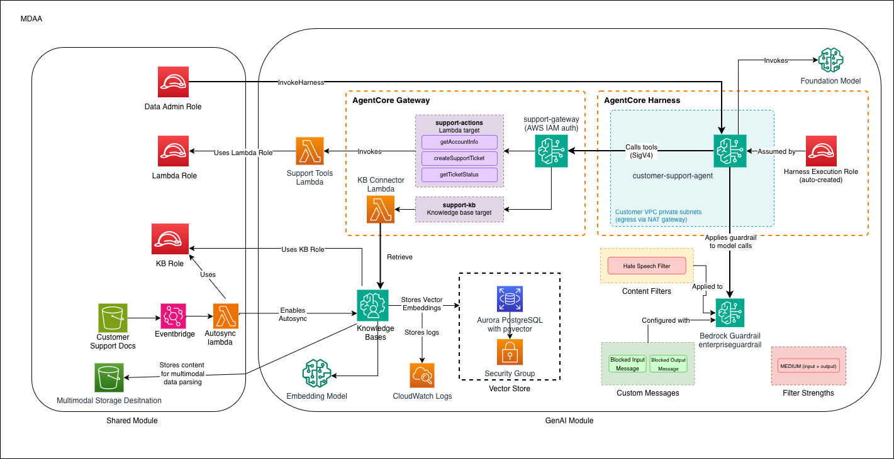

# GenAI Foundation

This starter kit deploys an enterprise-ready Customer Support Agent on Amazon Bedrock AgentCore: an AgentCore Harness that answers from a Bedrock Knowledge Base and calls customer support tools through an AgentCore Gateway, with a Bedrock Guardrail and a multi-sync architecture for concurrent document processing.

> **[Deployment Instructions](#deployment)**

## Use Cases

- Customer support agent assistant with natural language interaction
- Knowledge base search and retrieval over internal documents
- Document processing and analysis with RAG (Retrieval Augmented Generation)
- Multi-modal content handling (text and images)

## Capabilities

- AgentCore Harness agent with a managed agent loop, running in your VPC subnets
- AgentCore Gateway with AWS IAM auth, serving Lambda-backed customer support tools (over mock account and ticket data) and knowledge base search
- Knowledge Bases with vector stores for efficient retrieval, exposed to the agent as a gateway tool
- Guardrails for content safety
- Multi-sync architecture for concurrent file uploads
- KMS-encrypted S3 buckets for knowledge base data sources, and KMS-encrypted agent and gateway logs
- IAM roles with least-privilege Bedrock and AgentCore permissions

## Architecture

## Deployment

### Prerequisites and Predeployment

1. Authenticate to your target AWS account and region. Ensure the authenticated role has permissions to deploy resources via CDK.
2. [Bootstrap CDK](../../PREDEPLOYMENT.md#single-account-bootstrap) in your target account and region.
3. Choose a region where both the AgentCore harness and Bedrock Knowledge Bases are available. The harness is offered in fewer regions than the rest of AgentCore, so check its row in [AgentCore supported Regions](https://docs.aws.amazon.com/bedrock-agentcore/latest/devguide/agentcore-regions.html).
4. Provision a VPC with three private subnets and a security group:
   - The subnets must route outbound traffic through a NAT gateway. The agent harness and the vector store's password rotation function reach AWS services over it. For subnets without a NAT gateway, see [Private VPC](docs/USAGE.md#private-vpc).
   - Each subnet must be in an Availability Zone that [AgentCore supports for VPC connectivity](https://docs.aws.amazon.com/bedrock-agentcore/latest/devguide/agentcore-vpc.html), or the harness fails to create.
   - The security group must allow outbound HTTPS. The agent harness sessions use it.
5. Choose the Bedrock models you set in `mdaa.yaml` from the [supported models](https://docs.aws.amazon.com/bedrock/latest/userguide/models-supported.html), and make sure your account [has access to them](https://docs.aws.amazon.com/bedrock/latest/userguide/model-access.html).

Additional info: [PREDEPLOYMENT](../../PREDEPLOYMENT.md)

### Configure MDAA

1. Address all TODOs in [`mdaa.yaml`](mdaa.yaml), specifically:
   - Set `organization` to a globally unique name (used in S3 bucket names and all resource prefixes)
   - Set `vpc_id`, `subnet_id_1`, `subnet_id_2`, `subnet_id_3` to your VPC/subnet IDs
   - Set `security_group_id` to the security group for the agent harness sessions
   - Set `llm_model` to the Bedrock model ID or inference profile ID the agent calls
   - Set `kb_embedding_model` and `kb_parsing_model`

2. Address all TODOs in module configs, specifically:
   - CDK Nag suppressions in [`roles.yaml`](roles.yaml). Uncomment each suppression only after reviewing the associated permissions and confirming they are acceptable for your environment.

### Deploy MDAA

Run the following from the starter kit directory (containing `mdaa.yaml`):

1. Optionally, run `npx @aws-mdaa/cli ls` to understand what stacks will be deployed.

2. Optionally, run `npx @aws-mdaa/cli synth` and review the produced templates.

3. Run `npx @aws-mdaa/cli deploy` to deploy all modules.

Additional info: [DEPLOYMENT](../../DEPLOYMENT.md)

## Next Steps

See [USAGE](docs/USAGE.md) for post-deployment instructions including document upload and agent testing.

## Modules Deployed

| Module | Purpose |
|--------|---------|
| `@aws-mdaa/roles` | IAM roles (data-admin, data-user, harness-execution, kb-execution, agent-lambda, kb-sync-lambda) |
| `@aws-mdaa/datalake` | KMS-encrypted S3 buckets for knowledge base data sources |
| `@aws-mdaa/bedrock-builder` | AgentCore Harness, AgentCore Gateway and its tools, Knowledge Base, and Guardrail |

## Troubleshooting

1. **Harness fails to create with a subnet or Availability Zone error**: One of `subnet_id_1`, `subnet_id_2`, `subnet_id_3` is in an Availability Zone AgentCore does not support. Check the subnets' Availability Zone IDs (`aws ec2 describe-subnets --subnet-ids <id> --query "Subnets[].AvailabilityZoneId"`) against the [supported list](https://docs.aws.amazon.com/bedrock-agentcore/latest/devguide/agentcore-vpc.html), and use subnets in supported zones.

2. **The agent never answers, or the invocation times out**: The harness sessions cannot reach AWS. Check that the subnets route through a NAT gateway and that `security_group_id` allows outbound HTTPS. For subnets without a NAT gateway, configure the [Private VPC](docs/USAGE.md#private-vpc) endpoints.

3. **Access Denied when calling Bedrock**: Verify the `llm_model` in context values is correct and that model access is enabled. For cross-region inference, use the inference profile ID.

4. **Knowledge Base ingestion failures**: Verify S3 bucket permissions and KMS key access. Check that documents are uploaded with proper encryption. Monitor CloudWatch logs for detailed error messages.

5. **The agent answers without using its tools**: Check the harness, gateway, and gateway target status in the Amazon Bedrock AgentCore console, and the support tools function's CloudWatch logs. A tool call that fails reaches the agent as a generic error, so the function's logs hold the details.
