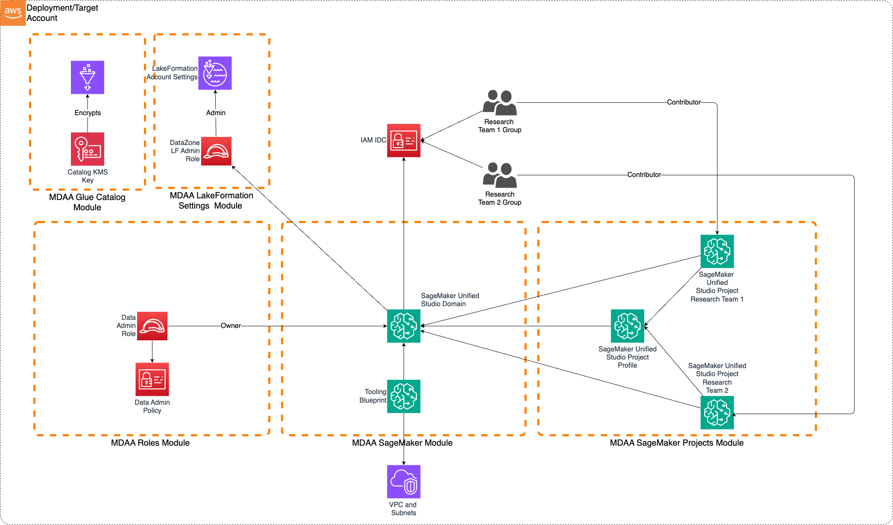

# SageMaker Unified Studio Research Environment

This starter kit deploys a SageMaker Unified Studio (SMUS) environment for organizations with multiple research teams operating within a single AWS account. It provides a governed ML platform where teams can collaborate on data and ML projects through the SMUS portal, with centralized identity management via IAM Identity Center.

> **[Deployment Instructions](#deployment)**

## Use Cases

- Multi-team research environments with shared governance in a single account
- Self-service ML platform access via SageMaker Unified Studio portal
- Team-based project isolation with SSO group membership
- Data science experimentation with integrated data governance via DataZone
- Rapid onboarding of research teams with standardized project profiles

## Capabilities

- SageMaker Unified Studio domain (DataZone V2) with SSO integration
- Project profiles for standardized team environments
- Team-based access control via IAM Identity Center groups
- Lake Formation governance for fine-grained data access
- Glue Catalog encryption for metadata security
- IAM roles for domain and data administration
- Onboarding of S3 data lake locations as SMUS data sources (two-phase setup: reading through the connection requires a post-deploy access grant and a second deploy — see [Troubleshooting](#troubleshooting) item 5)

## Architecture

## Deployment

### Prerequisites and Predeployment

1. Authenticate to your target AWS account and region. Ensure the authenticated role has permissions to deploy resources via CDK.
2. [Bootstrap CDK](../../PREDEPLOYMENT.md#single-account-bootstrap) in your target account and region. The account should be part of an AWS Organization for full Identity Center support.
3. Enable IAM Identity Center in the deployment region and create SSO groups for team1 and team2.

   > **⚠️ Standalone Account Limitation:** If deploying to an account not part of an AWS Organization, you must deploy in the same region where IAM Identity Center is enabled. Deploying to a different region will fail with: `IDC not enabled (Service: DataZone, Status Code: 400)`.

4. Provision a VPC with at least 2 private subnets. Subnets must have connectivity to AWS service endpoints, either via:
   - NAT Gateway for outbound internet access, OR
   - VPC Endpoints for:
     - SageMaker API
     - DataZone
     - STS
     - S3
     - CloudWatch Logs

Additional info: [PREDEPLOYMENT](../../PREDEPLOYMENT.md)

### Configure MDAA

1. Address all TODOs in [`mdaa.yaml`](mdaa.yaml), specifically:
   - Set `organization` to a globally unique name
   - Set `context` values:
     - `team1-group-sso-id` — SSO group name for team1
     - `team2-group-sso-id` — SSO group name for team2
     - `vpc_id` — VPC ID
     - `private_subnet_id1`, `private_subnet_id2` — private subnet IDs with AWS service connectivity

2. Address all TODOs in module configs, specifically:
   - CDK Nag suppressions in [`shared/roles.yaml`](shared/roles.yaml). Uncomment each suppression only after reviewing the associated permissions and confirming they are acceptable for your environment.

### Deploy MDAA

Run the following from the starter kit directory (containing `mdaa.yaml`):

1. Optionally, run `npx @aws-mdaa/cli ls` to understand what stacks will be deployed.

2. Optionally, run `npx @aws-mdaa/cli synth` and review the produced templates.

3. Run `npx @aws-mdaa/cli deploy` to deploy all modules in the order they appear in the config.

Additional info: [DEPLOYMENT](../../DEPLOYMENT.md)

## Next Steps

See [USAGE](USAGE.md) for post-deployment instructions.

## Modules Deployed

| Module | Purpose |
|--------|---------|
| `@aws-mdaa/glue-catalog` | Glue Catalog KMS encryption (account-level) |
| `@aws-mdaa/roles` | IAM roles for data and domain administration |
| `@aws-mdaa/lakeformation-settings` | Lake Formation settings (account-level) |
| `@aws-mdaa/audit` | Encrypted S3 bucket and KMS key for CloudTrail audit log storage |
| `@aws-mdaa/audit-trail` | CloudTrail trail for S3 data events |
| `@aws-mdaa/datalake` | S3 bucket for research data, onboarded as team1's SMUS data source |
| `@aws-mdaa/sagemaker` | SMUS domain (DataZone V2) with SSO integration |
| `@aws-mdaa/sagemaker-project` | SMUS project profiles and team projects |

## Troubleshooting

1. **`IDC not enabled` error during deployment**: IAM Identity Center must be enabled in the same region as your deployment. For standalone accounts, deploy in the region where Identity Center is enabled. Check your IDC region in the IAM Identity Center console.

2. **SSO users cannot access SMUS portal**: Verify the SSO group IDs in `mdaa.yaml` match the groups created in IAM Identity Center. Users must be members of the configured groups.

3. **Domain creation fails with PolicyGrant errors**: Ensure you are authenticated with credentials derived from IAM Identity Center (not static IAM credentials). Use `aws configure sso` to set up SSO-based authentication.

4. **Lake Formation permission errors**: Verify the Lake Formation admin roles are correctly configured in `shared/lakeformation-settings.yaml` and that the data-admin role has been granted LF admin permissions.

5. **"Access Denied" opening the `research-data` connection in the SMUS data catalog**: The bucket's own `accessPolicies` in [`shared/datalake.yaml`](shared/datalake.yaml) (`ReadWriteSuperRoles: [DataAdmin]`) deny every other principal by default, including team1's SMUS environment role, which this data source relies on for read access. That role does not exist until after the `sagemaker-project` module has deployed, so granting it access takes a post-deploy step and a second deploy:
   1. In the SMUS portal, open the `team1` project's **Project overview** and copy its environment user role ARN.
   2. In [`shared/datalake.yaml`](shared/datalake.yaml), add that ARN under `roles` (e.g. `Team1Env: [{arn: <copied-arn>}]`) and add an `accessPolicies` entry granting it `ReadRoles` on the `raw/` prefix.
   3. Redeploy the `datalake` module.
